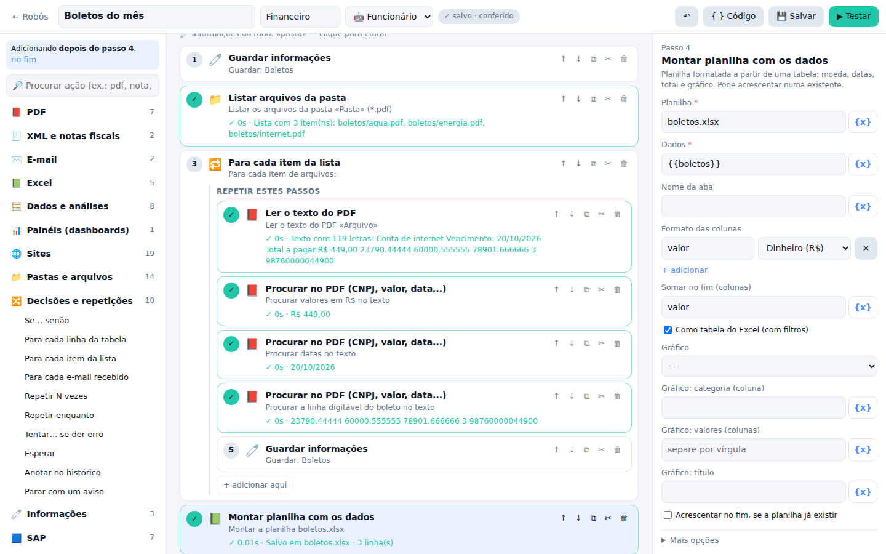
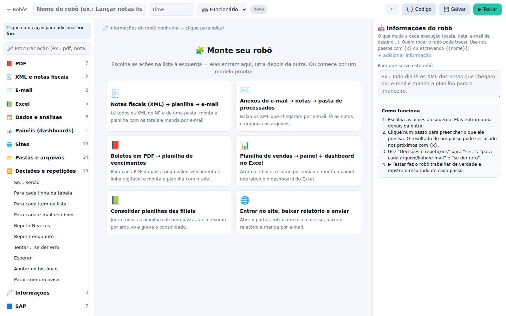
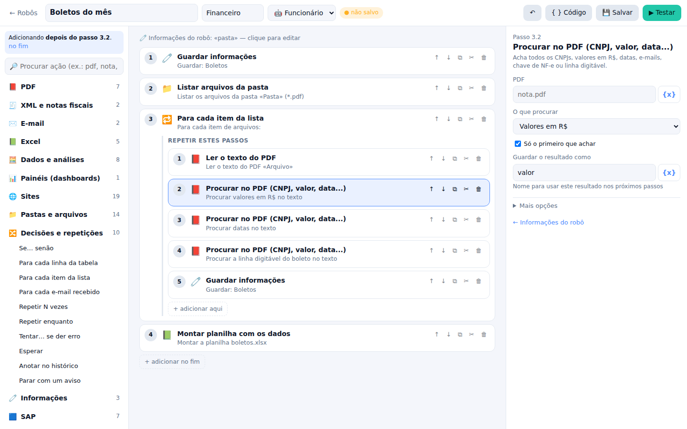
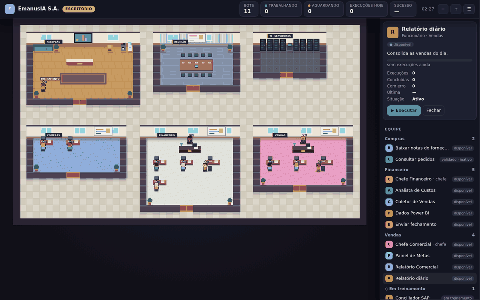
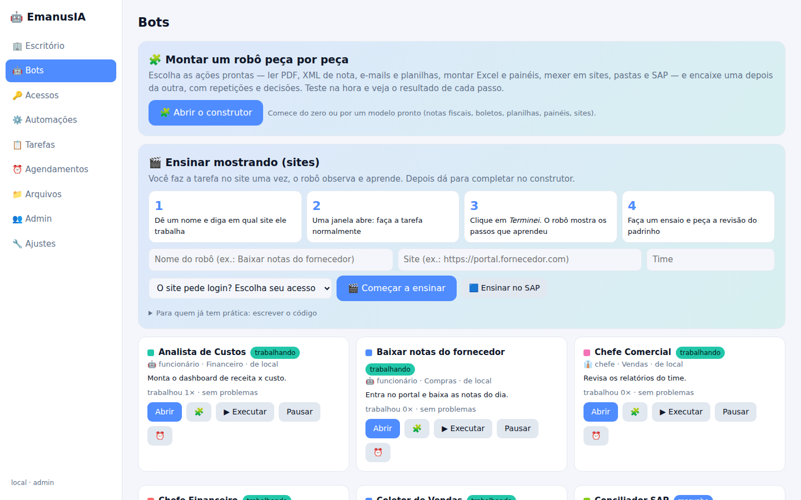
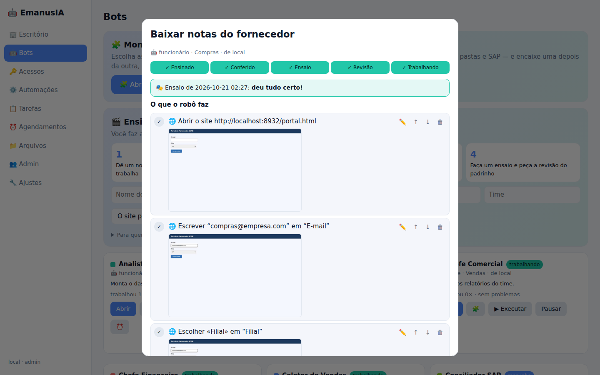
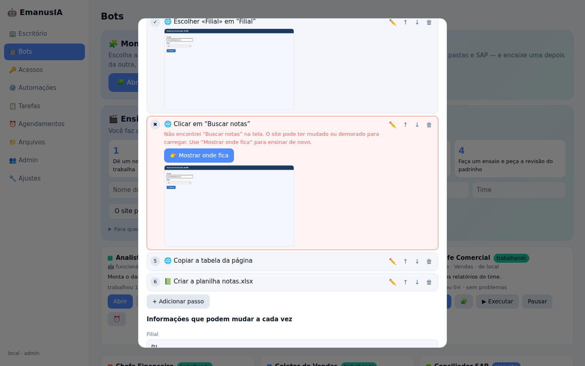
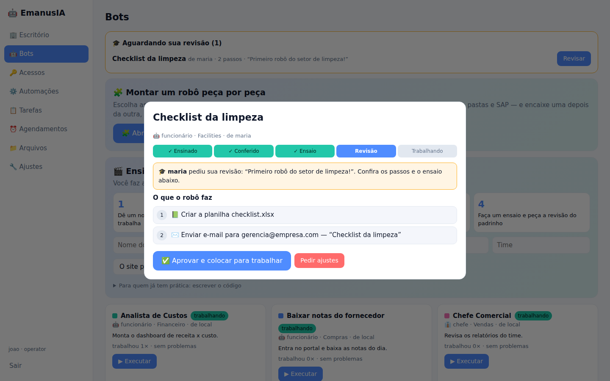
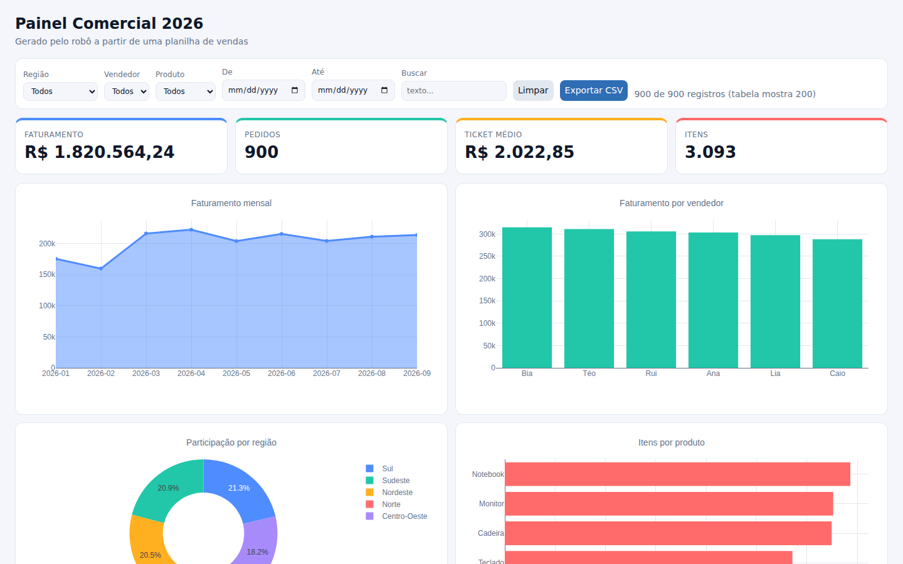
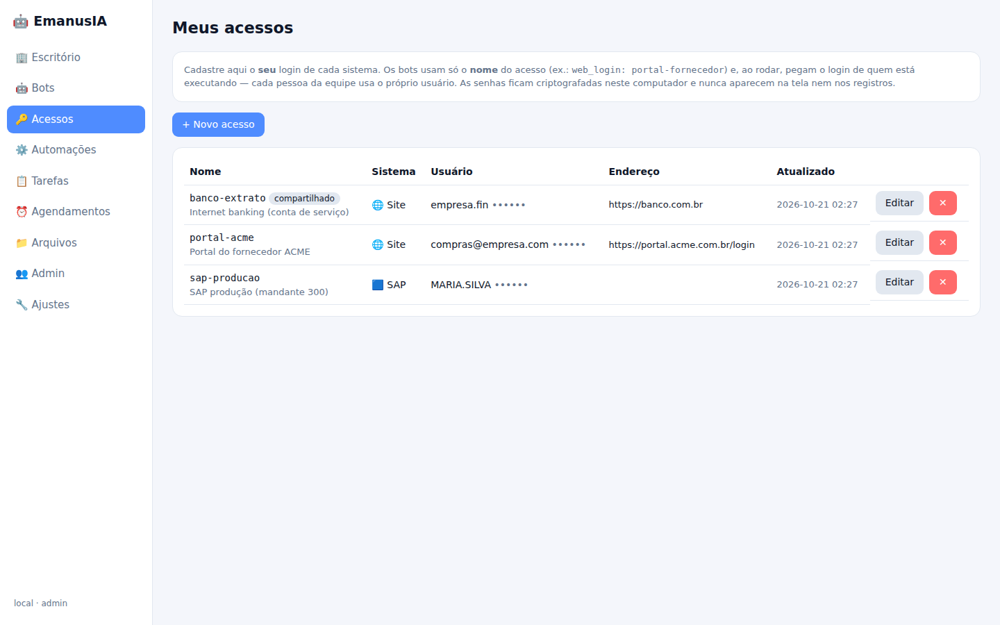

# 🤖 EmanusIA — sua empresa de funcionários-robô

Plataforma local (roda no seu PC, sem nuvem e sem IA pesada) onde a equipe **monta robôs sem
programar**, encaixando ações prontas: ler PDFs e XML de notas fiscais, ler e-mails e baixar anexos,
ler e montar planilhas Excel, criar dashboards, organizar pastas, operar sites, SAP e outros
programas — com decisões ("se o valor for maior que…") e repetições ("para cada arquivo da pasta").
Tudo aparece num **escritório em pixel art** que cresce conforme a empresa contrata mais bots.

  

<p align="center"></p>
<p align="center"><i>O construtor: as peças ficam à esquerda, o robô no meio e o formulário do passo à direita. Depois do ▶ Testar, cada passo mostra ✓, o tempo e o que produziu.</i></p>

## 📸 Telas

| | |
|---|---|
| <br>**Comece por um modelo** — notas fiscais, boletos, e-mails, planilhas, painéis, sites. | <br>**Cada peça tem um formulário em português**; o botão {x} usa o resultado de passos anteriores. |
| <br>**Escritório ao vivo**: o chefe delega, os robôs entregam e voltam às mesas. | <br>**Bots**: montar no construtor ou ensinar mostrando no site. |
| <br>**Passos em português** + ensaio com um print de cada passo. | <br>**O site mudou?** O passo fica vermelho, com **👉 Mostrar onde fica**. |
| <br>**Revisão do padrinho** antes do robô começar a trabalhar. | <br>**Ações importantes pedem permissão**, em linguagem comum. |
| <br>**Dashboards interativos** gerados a partir de planilhas (filtros, período, exportação). | <br>**Acessos**: cada pessoa guarda o próprio login; senhas criptografadas. |

> As imagens são geradas pelo próprio sistema rodando (`python scripts/screenshots.py`) com uma empresa de exemplo.

## Instalação (Windows)
1. Instale o **Python 3.10+** (marque "Add Python to PATH").
2. Dê dois cliques em `instalar.bat` (uma vez). Ele instala tudo e o navegador dos robôs — não há
   modelo de IA para baixar.
3. `abrir.bat` abre o sistema. Para ver uma empresa de exemplo: `emanusia demo`.
4. Algo não funcionou? Dê dois cliques em **`diagnostico.bat`**: ele diz o que falta e como consertar.

Manual: `pip install -e ".[all,dev]"` e `playwright install chromium`.

## 🧩 Construtor de robôs (sem código)
Em **Bots → 🧩 Abrir o construtor**:
1. Escolha um **modelo pronto** ou comece do zero.
2. Clique nas **peças** à esquerda (busca por "pdf", "nota", "e-mail", "planilha"...). Elas entram
   uma depois da outra; dentro de *Se…* e *Para cada…* há o botão “+ adicionar aqui”.
3. Preencha o **formulário** de cada passo. Dê nome ao resultado (ex.: `notas`) e use-o depois com {x}.
4. **▶ Testar**: o robô trabalha de verdade e cada passo mostra ✓/✖, o tempo e uma prévia do resultado.
5. Depois do teste, peça a **revisão do padrinho** e coloque para trabalhar (ou agende).

| Assunto | O que dá para fazer |
|---|---|
| **📕 PDF** | Ler o texto; achar CNPJ, CPF, valores em R$, datas, e-mails, chave da NF-e, linha digitável; pegar campos pelo rótulo (“Valor total”, “Vencimento”); tirar tabelas; juntar e separar páginas. |
| **🧾 XML e notas fiscais** | Ler NF-e de uma pasta inteira: uma linha por nota (chave, número, emissão, emitente, destinatário, total, ICMS, IPI...) ou por produto; ler qualquer XML como tabela. |
| **✉️ E-mail** | Ler a caixa do Outlook com filtros (assunto, remetente, últimos dias, só com anexo PDF/XML) salvando os anexos numa pasta; enviar com anexos. SMTP/IMAP configurável. |
| **📗 Excel** | Montar planilha formatada (R$, datas, total, tabela, gráfico) ou acrescentar linhas numa existente; ler; atualizar células; dashboard nativo do Excel com fórmulas vivas; atualizar Power Query/macro. |
| **🧮 Dados** | Filtrar, agrupar e somar; tabela dinâmica; PROCV/conciliação; limpar (duplicados, R$ 1.234,56 → número, datas); consolidar várias planilhas; colunas calculadas. |
| **📊 Painéis** | Painel HTML interativo: indicadores, gráficos, filtros por coluna e período, tabela ordenável, exportação. |
| **🌐 Sites** | Abrir, entrar com o acesso de quem roda, clicar, preencher, escolher, esperar, copiar tabelas e listas, baixar e enviar arquivos, quadros internos, abas. Ou **ensinar mostrando**. |
| **📁 Pastas** | Para cada arquivo da pasta; listar, copiar, mover, renomear, apagar, compactar/descompactar, ler/gravar texto e JSON — só nas **pastas liberadas** pelo admin. |
| **🔀 Fluxo** | Se… senão (condição em linguagem comum), para cada linha/item/e-mail/arquivo, repetir N vezes ou enquanto, tentar… se der erro, esperar, parar com aviso, guardar e calcular informações. |
| **🟦 SAP · 🖥 Programas · 🔌 Sistemas** | Transações, campos, botões e relatórios ALV do SAP; clicar e digitar em programas do Windows; APIs REST, bancos SQL, Power BI. |
| **🤝 Outros robôs** | Um robô chefe passa o trabalho para outros (aparece no escritório). |

> 📐 Arquitetura completa, tecnologias, o que foi testado e o passo a passo de instalação: **[docs/ARQUITETURA.md](docs/ARQUITETURA.md)**

## Ensinar mostrando, revisão e linguagem comum
1. **Ensinar mostrando** (aba Bots): dá um nome, diz o site e clica em *Começar a ensinar*. Uma janela
   abre, a pessoa faz a tarefa normalmente e clica em *Terminei*. Cada clique vira um passo com o nome
   que aparece na tela (“Clicar em *Buscar notas*”). Senhas não são gravadas: se escolher um acesso,
   o robô usa o login cadastrado de quem rodar.
2. **Passos em português**: a página do robô mostra o que ele faz como uma lista legível, com
   editar/subir/descer/apagar por formulário. O código fica escondido em *Modo avançado*.
3. **Ensaio**: o robô faz a tarefa de verdade e tira um print de cada passo. Se o site mudou, o passo
   fica vermelho com a explicação (“Não encontrei *Buscar notas* na tela…”) e o botão
   **👉 Mostrar onde fica**: o robô refaz os passos anteriores e o primeiro clique da pessoa ensina o
   lugar novo. Robôs que mexem em telas (site, SAP, programas) só trabalham depois de um ensaio que deu certo.
4. **Revisão do padrinho**: robô criado por quem não é padrinho/admin só começa a trabalhar depois que
   um padrinho aprova (ou pede ajustes com um recado). Qualquer mudança depois exige nova revisão.
   Marque o usuário como padrinho em Admin (ou `emanusia user add maria --reviewer`).
5. **Adicionar passos** a um robô pronto: *mostrando* (o robô refaz até o ponto escolhido e grava o que
   a pessoa fizer dali em diante) ou por **ações prontas** (enviar e-mail, esperar, abrir site, salvar
   tabela da página em planilha, montar painel). Funciona também dentro de quadros internos (iframes).
6. **Ensinar no SAP**: grave a tarefa com o gravador do próprio SAP (Alt+F12) e envie o `.vbs`; o
   sistema converte em passos em português (senhas nunca são importadas).
7. **Linguagem comum** em tudo: erros (“Você ainda não cadastrou o seu acesso *erp*”), pedidos de
   autorização (“O robô vai ENVIAR um e-mail para gerente@… com 1 anexo. Pode enviar?”) e
   formulário com as informações que mudam a cada execução.

## Linguagem dos bots (YAML validado)
```yaml
params: {url: "https://portal.fornecedor.com", destino: "financeiro@empresa.com"}
steps:
  - tool: web_login            # usa o acesso "portal" de quem está rodando
    args: {credential: portal}
  - set: {pedidos: [], pagina: 1, tem_proxima: true}
  - while: "tem_proxima and pagina <= 20"
    steps:
      - tool: web_extract
        args: {item_selector: .pedido, fields: {numero: .num, valor: .valor}}
        save_as: lote
      - set: {pedidos: "=pedidos + lote", pagina: "=pagina + 1"}
      - tool: web_exists
        args: {selector: "button.proxima:not([disabled])"}
        save_as: tem_proxima
      - if: "tem_proxima"
        then: [{tool: web_click, args: {selector: button.proxima}}]
  - tool: excel_dashboard
    args: {path: pedidos.xlsx, source: "{{pedidos}}", title: Pedidos,
           kpis: [{label: Total, column: valor, agg: sum, format: money}]}
    retry: 2
  - call_bot: analista-financeiro   # passa o trabalho para outro bot (aparece no escritório)
  - tool: email_send                # Outlook; pede autorização ao rodar
    args: {to: "{{destino}}", subject: Pedidos, body: Segue., attachments: [pedidos.xlsx]}
```
O construtor gera este YAML; quem tem prática pode editá-lo em *Modo avançado*.
Passos: `tool`, `if/then/else`, `for_each`, `while`, `try/catch`, `set` (`=` avalia expressão),
`call` (workflow), `call_bot`, `log`, `sleep`, `fail`; em ferramentas: `retry`, `on_error: continue`,
`if`. Expressões são seguras (sem código Python). O validador recusa ferramenta ou argumento
inexistente, senha escrita no código, expressões inválidas e chamadas para bots/workflows que não
existem. Exemplo completo: `workflows/exemplo-portal-completo.yaml`.

## Segurança
- Ações que alteram sistemas (enviar e-mail, clicar em "excluir/pagar/aprovar", gravar no SAP, SQL de
  escrita, macros) pedem **Autorizar/Negar**; agendamentos sem supervisão só por admin.
- Papéis admin/operator/viewer, permissões por ferramenta, auditoria com segredos mascarados.
- Só `127.0.0.1` por padrão. Para a equipe acessar pela rede: `emanusia serve --lan` (exige login;
  sem HTTPS, use apenas em rede interna).
- Arquivos presos à pasta `workspace/` e às pastas que o admin liberar em Ajustes.

## Comandos
```
emanusia gui | serve [--lan] | demo | doctor
emanusia bot list|validate|run|activate|pause <id>
emanusia record <url> <nome> | workflow <nome> | user add <nome> --role admin | tools
```
Uma tarefa por vez é executada (navegador e SAP não suportam paralelismo); as demais ficam na fila.

Testes: `pytest`
