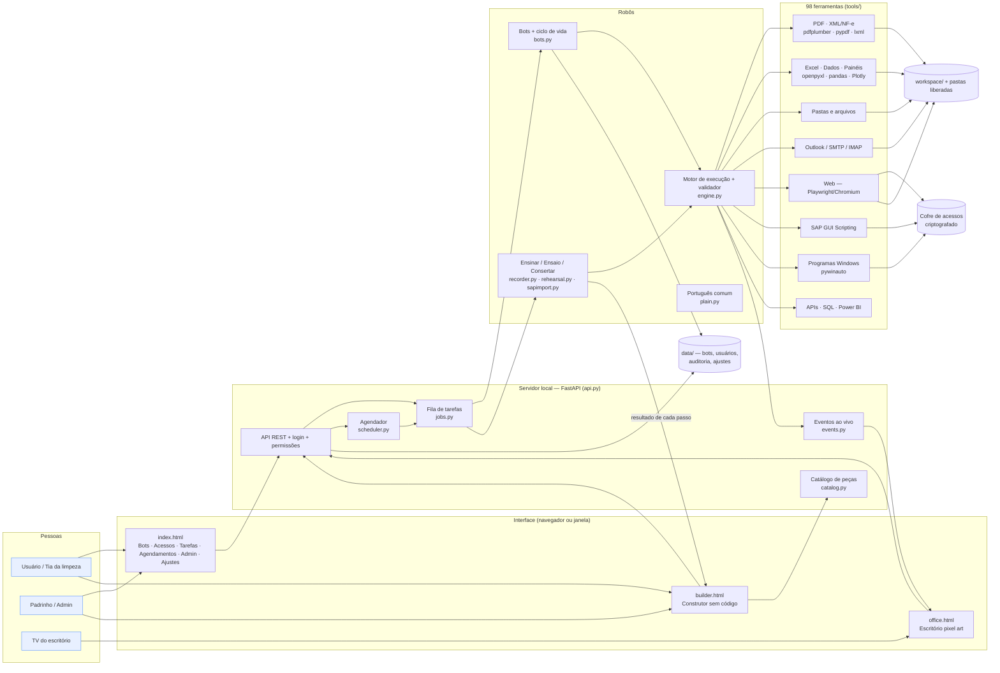

# EmanusIA — Arquitetura, tecnologias e como colocar para funcionar

## 1. Visão geral

O EmanusIA é um único programa **Python** que roda no seu PC com Windows. Ele abre uma **interface
web local** (no navegador ou em janela própria) onde a equipe **monta robôs sem programar** — encaixando
ações prontas — e os coloca para trabalhar em PDFs, XML de notas fiscais, e-mails, planilhas, painéis,
sites, pastas, SAP e outros programas. Não há IA nem modelo para baixar: o sistema é leve, rápido e
cada passo do robô é previsível e conferido antes de rodar.



## 2. Tecnologias

| Camada | Tecnologia | Para quê |
|---|---|---|
| Linguagem | **Python 3.10+** | Todo o sistema |
| Servidor | **FastAPI** + **Uvicorn** | API da interface; só `127.0.0.1` (ou rede interna com `--lan`) |
| Interface | HTML + CSS + JavaScript puros (sem framework) | Telas, construtor e escritório em **canvas pixel art** |
| Janela nativa | **pywebview** (opcional) | Abrir como aplicativo em vez de aba do navegador |
| PDF | **pdfplumber** (texto e tabelas) + **pypdf** (juntar/separar) | Boletos, faturas, extratos, relatórios |
| XML / NF-e | **lxml** (sem entidades externas: seguro contra XML malicioso) | Notas fiscais e qualquer XML como tabela |
| Excel | **openpyxl** | Planilhas formatadas, fórmulas, gráficos, dashboard nativo, acrescentar linhas |
| Dados | **pandas** | Filtrar, agrupar, tabela dinâmica, PROCV, limpeza, consolidação |
| Painéis | **Plotly** (embutido, offline) | Painéis HTML interativos com filtros |
| Automação web | **Playwright** + Chromium | Clicar, preencher, iframes, abas, downloads, prints |
| SAP | **SAP GUI Scripting** via **pywin32** (COM) | Transações, campos, relatórios ALV |
| Programas Windows | **pywinauto** + **pyautogui** | Qualquer software de desktop |
| E-mail | **Outlook** (COM/pywin32) ou **SMTP/IMAP** | Ler com filtros, baixar anexos, enviar |
| Segurança | **cryptography** (Fernet/AES) + **DPAPI** do Windows, PBKDF2 | Cofre de senhas, login dos usuários |
| Armazenamento | Arquivos **YAML/JSON** em `data/` | Simples de copiar/backup; sem banco de dados para instalar |
| Testes | **pytest** (107 testes, incluindo navegador real) | Garantir que nada quebra |

## 3. Como as peças funcionam

**Robô (bot)** = nome + time + cargo + "código" em YAML (lista de passos). A pessoa comum nunca precisa
ver o YAML: ela monta no **construtor** e vê os passos em português (`plain.py`).

### 3.1 Construtor sem código (`builder.html` + `catalog.py`)
- **Peças por assunto** (109): PDF, XML e notas fiscais, E-mail, Excel, Dados e análises, Painéis,
  Sites, Pastas e arquivos, Decisões e repetições, Informações, SAP, Programas do Windows, Sistemas
  (API e banco), Outros robôs — e "Outras ações" com as ferramentas restantes.
- **Formulário em português** para cada peça: campo de arquivo, lista de colunas, tabela de
  indicadores/gráficos, escolha de acesso, de outro robô etc. Opções técnicas ficam em "Mais opções"
  (só fazer se…, se der erro seguir, tentar de novo, anotação).
- **Informações entre passos**: o resultado de um passo ganha um nome (`notas`, `emails`, `texto_pdf`)
  e o botão **{x}** insere nos próximos passos (`{{notas}}`, `{{email.subject}}`, `{{linha.Valor}}`).
  Depois de um teste, as colunas reais das tabelas aparecem na lista.
- **Decisões e repetições**: *Se… senão* com condição montada em linguagem comum ("Valor — é maior
  que — 1000"), *Para cada arquivo da pasta*, *para cada linha da tabela*, *para cada e-mail*,
  *repetir N vezes / enquanto*, *tentar… se der erro*, esperar, parar com aviso.
- **Editar**: subir/descer (sai do bloco nas pontas), duplicar, recortar e colar dentro de outro bloco,
  apagar, desfazer (Ctrl+Z), salvar (Ctrl+S).
- **Conferência contínua**: a cada mudança o validador roda e o passo com problema fica vermelho com
  a explicação ("falta informar nome do arquivo").
- **▶ Testar**: o robô trabalha de verdade (é o ensaio do ciclo de vida) e cada passo mostra ✓/✖, o
  tempo e uma prévia do resultado (tabela, lista, texto, arquivo salvo), além do print quando há tela.
- **Modelos prontos**: processo completo (site → Excel → dashboard → outro programa → relatório → e-mails com análise, com aviso se der erro); notas fiscais XML → planilha → e-mail; anexos do e-mail → notas → pasta de
  processados; boletos em PDF → planilha de vencimentos; vendas → painel + dashboard do Excel;
  consolidar planilhas de filiais; entrar no site, baixar relatório e enviar.

### 3.2 Principais peças novas
| Assunto | Peças |
|---|---|
| PDF | ler texto; procurar CNPJ/CPF/valor/data/e-mail/chave de NF-e/linha digitável; pegar campos pelo rótulo ("Valor total", "Vencimento"); tirar tabelas; juntar; separar páginas; informações |
| XML | ler NF-e (uma linha por nota ou por produto: chave, número, emissão, emitente, destinatário, valores e impostos); ler qualquer XML como tabela (tag que se repete + caminhos) |
| E-mail | ler com filtros (assunto, remetente, últimos N dias, só com anexo pdf/xml…) salvando os anexos numa pasta; enviar com anexos por padrão (`saida/*.pdf`) |
| Excel | montar planilha a partir de dados (formatos, total, tabela, gráfico, acrescentar no fim); ler; atualizar células/linhas; dashboard nativo; atualizar consultas/macro |
| Pastas | listar, copiar, mover, renomear, apagar (pede autorização), criar pasta, compactar/descompactar (protegido contra "zip malicioso"), ler/gravar texto e JSON |
| Análise | `data_insights`: totais, variação do último mês (e sem os valores fora do padrão), melhores/piores por dimensão, concentração (Pareto), registros fora do padrão, dados faltando/duplicados, meta; devolve `findings`, `suggestions`, `text` e `html` para o e-mail — tudo por regras transparentes |
| Cálculos | `to_number("R$ 1.234,56")`, `money(x)`, `today()`, `date_add(d, 30)`, `format_date`, `days_between`, `replace`, `split`, `join`, `regex_find`, `column(tabela, "Valor")`, `records(tabela)`… |

### 3.3 Ciclo de vida do robô (`bots.py`)
```
Montado/ensinado → Conferido (validador) → Ensaio/Teste (execução real) → Revisão (padrinho) → Trabalhando
```
- *Conferido*: o validador (`engine.validate`) checa ações, informações obrigatórias, permissões, senhas
  escritas no código e condições. Qualquer mudança volta para rascunho.
- *Ensaio*: obrigatório para robôs que mexem em telas (site, SAP, programas).
- *Revisão*: obrigatória quando quem criou não é padrinho/admin.
- Tudo fica preso a uma "impressão digital" do código (hash): mudou o robô, refaz ensaio e revisão.

### 3.4 Outras formas de criar
1. *Ensinar mostrando* no site (`recorder.py`): cada clique vira passo com o nome visível do botão;
   funciona dentro de quadros (iframes); senhas viram "acesso cadastrado". Depois, completa no construtor.
2. *Ensinar no SAP* (`sapimport.py`): importa o arquivo `.vbs` do gravador do próprio SAP.
3. *Adicionar passos mostrando* no meio de um robô (o robô refaz até o ponto e grava o resto).
4. *Modo avançado*: editar o YAML direto.

**Consertar** (`rehearsal.py`): se o site mudou, o ensaio mostra o passo em vermelho; em
*Mostrar onde fica* o robô refaz tudo até logo antes daquele passo e aprende o lugar novo com o
clique da pessoa.

**Execução** (`jobs.py`): uma fila com **1 tarefa por vez** (navegador e SAP não suportam
paralelismo). Ações de risco (enviar e-mail, apagar arquivos, clicar em aprovar/pagar/excluir, gravar
no SAP, SQL de escrita, macros) **pausam e pedem permissão** em linguagem comum. O agendador dispara
robôs ativos.

**Pastas liberadas** (`config.safe_path`): os robôs só leem e gravam na pasta de trabalho e nas pastas
que o admin liberar em **Ajustes → Pastas liberadas** (ex.: `C:\Notas Fiscais`, `\\servidor\financeiro`).
Qualquer outro caminho é recusado.

**Escritório** (`office.html`): lê `/api/office` a cada 1,5 s (status + eventos) e anima: bots
trabalhando nas mesas, entregando ao chefe, passando trabalho a colegas, pedindo aprovação.

**Acessos** (`vault.py`): cada pessoa guarda o próprio usuário/senha de cada sistema. O robô guarda
só o *nome* do acesso e usa o de quem estiver rodando. Senhas nunca vão para a tela, os logs nem o
código do robô.

## 4. Onde ficam os dados

| Pasta | Conteúdo | Backup? |
|---|---|---|
| `data/bots/` | um arquivo por robô | **Sim** |
| `data/users.yaml` | usuários (senhas com hash) | **Sim** |
| `data/vault.json` + `data/vault.key` | acessos criptografados + chave (protegida pelo Windows) | **Sim, juntos**. A chave só abre no mesmo usuário do Windows |
| `data/audit.jsonl` | trilha de auditoria | Recomendado |
| `data/rehearsals/` | prints dos ensaios | Não |
| `data/schedules.json`, `settings.json` | agendamentos e ajustes (inclui as pastas liberadas) | Sim |
| `workspace/` | planilhas, painéis e arquivos gerados | Conforme uso |
| `workflows/` | automações avulsas (modo avançado) | Sim |

## 5. O que foi testado e o que falta testar

| Parte | Situação |
|---|---|
| Construtor (montar, conferir, salvar, testar com resultado por passo) no navegador real | **Testado aqui** |
| PDF (texto, procurar, campos, juntar, separar), NF-e e XML, pastas, zip, JSON, Excel, dados, painéis | **Testado aqui** |
| E-mail: filtros e anexos (IMAP simulado), SMTP (simulado) | **Testado aqui** |
| Motor, validador, bots, revisão, ensaio, consertar, inserir passos, iframes, gravação, cofre, API, telas | **Testado aqui** (107 testes automáticos + navegador real headless) |
| Importar gravação do SAP (.vbs → passos) | **Testado** (conversão). Rodar no SAP: **não testado** |
| Execução real no SAP, Outlook, Excel via COM (`excel_refresh`), programas Windows, DPAPI | **Não testado** — exigem Windows com esses programas |
| PDF escaneado (imagem) | Não suportado: o texto vem vazio (`pdf_info` avisa) |

## 6. Como colocar para funcionar (Windows)

### 6.1 Instalar (uma vez)
1. **Python 3.11** em python.org — marque **"Add Python to PATH"** na instalação.
2. **Git** (git-scm.com) e baixe o projeto:
   `git clone https://github.com/emanuelpms/EmanusIA.git` e `git checkout claude/kind-bardeen-hishpj`
   (ou baixe o ZIP dessa branch no GitHub).
3. Dentro da pasta, dê dois cliques em **`instalar.bat`**. Ele cria o ambiente, instala tudo e
   instala o Chromium dos robôs (alguns minutos; não há modelo de IA para baixar).

### 6.2 Primeiro uso
1. **`abrir.bat`** (ou `emanusia gui`). Abre em `http://127.0.0.1:8765`.
2. Opcional: `emanusia demo` para ver uma empresa de exemplo no Escritório.
3. **Crie o admin**: aba Admin → usuário com papel *admin* (a partir daí o login é exigido).
   Crie os demais usuários e marque os **padrinhos**.
4. **Ajustes**: nome da empresa; e-mail (Outlook já é o padrão — basta o Outlook estar aberto e
   logado); **pastas liberadas** (onde chegam os PDFs/XML, pastas da rede).
5. Cada pessoa cadastra seus **Acessos** (portais, SAP).
6. **Bots → 🧩 Abrir o construtor**: comece por um modelo pronto ou do zero, clique em ▶ Testar.

### 6.3 Para o SAP
- No servidor SAP (Basis): transação **RZ11**, parâmetro `sapgui/user_scripting` = **TRUE**.
- No SAP GUI de cada PC: *Opções → Acessibilidade e scripting → Scripting* → **ativar**, e desmarcar
  "notificar quando um script se conectar".
- Para ensinar: Alt+F12 → *Gravação e reprodução de script* → gravar → fazer a tarefa → parar →
  enviar o `.vbs` em **Bots → 🟦 Ensinar no SAP**. Ou monte no construtor (categoria SAP).

### 6.4 Para a equipe acessar pela rede (opcional)
`emanusia serve --lan` (exige usuários criados) e liberar a porta 8765 no Firewall do Windows. Sem
HTTPS: use só na rede interna da empresa. O Escritório fica em `http://<ip-do-pc>:8765/office` (ideal
para uma TV).

### 6.5 Problemas comuns
**Primeiro passo sempre:** dê dois cliques em **`diagnostico.bat`** (ou `emanusia doctor`, ou Ajustes →
🩺 Diagnóstico). Ele confere Python, pacotes, navegador dos robôs, cofre e integrações do Windows
(Outlook, Excel, SAP) e mostra o conserto de cada item. Erros completos ficam em `data/logs/emanusia.log`.

| Sintoma | Causa provável / solução |
|---|---|
| "Pasta não liberada para os robôs" | O admin libera a pasta em Ajustes → Pastas liberadas |
| PDF lido vem sem texto | PDF escaneado (imagem): peça o PDF original ao fornecedor |
| "Outlook só funciona no Windows..." | Outlook fechado ou não instalado; ou troque para SMTP em Ajustes |
| SAP: "GetObject SAPGUI" falha | SAP Logon não aberto ou scripting desativado (6.3) |
| Cofre não abre em outro PC | A chave é presa ao usuário do Windows; recadastre os acessos no PC novo |
| Robô parou: "Não encontrei ... na tela" | O site mudou: abra o robô → **Mostrar onde fica** → novo ensaio |

## 7. Limites atuais e próximos passos sugeridos
- **Uma tarefa por vez** por PC. Para escalar: rodar vários PCs "robô" com fila compartilhada.
- **HTTPS** para uso em rede (hoje só rede interna).
- **OCR** para PDFs escaneados (ex.: Tesseract) como peça opcional.
- **Programas Windows** ainda sem gravação (monta-se pelo construtor).
- **Instalador .exe** (PyInstaller) para não depender de Python instalado.
- **Backup automático** da pasta `data/`.
