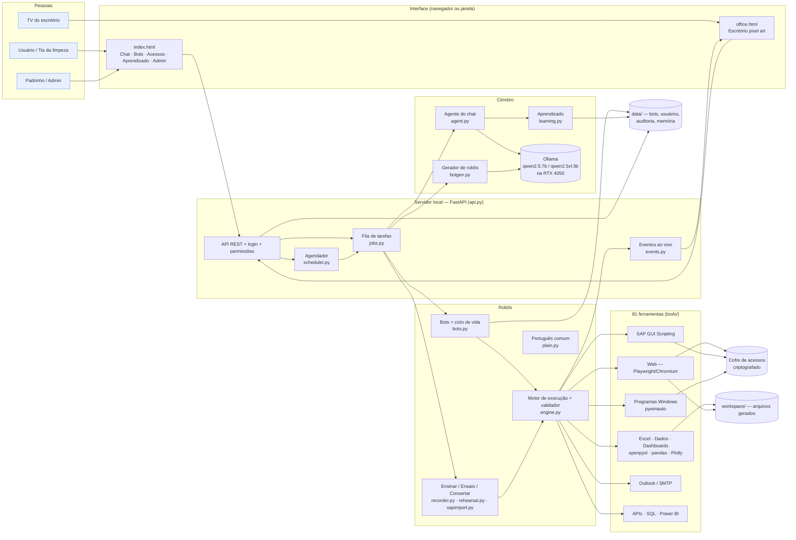

# EmanusIA — Arquitetura, tecnologias e como colocar para funcionar

## 1. Visão geral

O EmanusIA é um único programa **Python** que roda no seu PC com Windows. Ele abre uma **interface
web local** (no navegador ou em janela própria) e executa **robôs (bots)** que operam sites, planilhas,
e-mail, SAP e outros programas. A "inteligência" (chat, gerar robô a partir de texto, visão) vem de um
**modelo de IA local via Ollama**: nada sai da máquina.



## 2. Tecnologias

| Camada | Tecnologia | Para quê |
|---|---|---|
| Linguagem | **Python 3.10+** | Todo o sistema |
| IA local | **Ollama** + **Qwen 2.5 7B** (texto/ferramentas) e **Qwen 2.5-VL 3B** (visão) | Chat, gerar robôs, olhar a tela. Cabem nos 6 GB da RTX 4050 |
| Servidor | **FastAPI** + **Uvicorn** | API da interface; só `127.0.0.1` (ou rede interna com `--lan`) |
| Interface | HTML + CSS + JavaScript puros (sem framework) | Telas e escritório em **canvas pixel art** desenhado por código |
| Janela nativa | **pywebview** (opcional) | Abrir como aplicativo em vez de aba do navegador |
| Automação web | **Playwright** + Chromium | Clicar, preencher, iframes, abas, downloads, prints |
| Excel | **openpyxl** | Planilhas formatadas, fórmulas, gráficos, dashboard nativo |
| Dados | **pandas**, **pdfplumber**, **lxml** | Análise, limpeza, PROCV, tabelas de PDF/HTML |
| Dashboards | **Plotly** (embutido, offline) | Painéis HTML interativos |
| SAP | **SAP GUI Scripting** via **pywin32** (COM) | Transações, campos, relatórios ALV |
| Programas Windows | **pywinauto** + **pyautogui** | Qualquer software de desktop |
| E-mail | **Outlook** (COM/pywin32) ou **SMTP/IMAP** | Enviar/ler e-mails |
| Segurança | **cryptography** (Fernet/AES) + **DPAPI** do Windows, PBKDF2 | Cofre de senhas, login dos usuários |
| Armazenamento | Arquivos **YAML/JSON** em `data/` | Simples de copiar/backup; sem banco de dados para instalar |
| Testes | **pytest** (102 testes, incluindo navegador real) | Garantir que nada quebra |

## 3. Como as peças funcionam

**Robô (bot)** = nome + time + cargo + "código" em YAML (lista de passos). A pessoa comum nunca vê o
YAML: ela vê os passos em português (`plain.py`).

**Ciclo de vida do robô** (`bots.py`):
```
Ensinado → Conferido (validador) → Ensaio (execução real com prints) → Revisão (padrinho) → Trabalhando
```
- *Conferido*: o validador (`engine.validate`) checa ações, informações obrigatórias, permissões, senhas
  escritas no código e condições. Qualquer mudança volta para rascunho.
- *Ensaio*: obrigatório para robôs que mexem em telas (site, SAP, programas).
- *Revisão*: obrigatória quando quem criou não é padrinho/admin.
- Tudo fica preso a uma "impressão digital" do código (hash): mudou o robô, refaz ensaio e revisão.

**Formas de criar um robô**
1. *Ensinar mostrando* no site (`recorder.py`): cada clique vira passo com o nome visível do botão;
   funciona dentro de quadros (iframes); senhas viram "acesso cadastrado".
2. *Ensinar no SAP* (`sapimport.py`): importa o arquivo `.vbs` do gravador do próprio SAP.
3. *Adicionar passos*: mostrando no meio do robô (o robô refaz até o ponto e grava o resto) ou por
   ações prontas (e-mail, esperar, tabela → planilha, painel...).
4. *Descrever para a IA* (`botgen.py`): a IA escreve, o validador aponta erros, a IA corrige.
5. *Aprendizado* (`learning.py`): rotinas repetidas no chat viram sugestões de robôs.
6. *Modo avançado*: YAML com `se/senão`, `repetir`, `tentar/se der erro`, `passar para outro bot`.

**Consertar** (`rehearsal.py`): se o site mudou, o ensaio mostra o passo em vermelho; em
*Mostrar onde fica* o robô refaz tudo até logo antes daquele passo (em qualquer nível) e aprende o
lugar novo com o clique da pessoa.

**Execução** (`jobs.py`): uma fila com **1 tarefa por vez** (navegador e SAP não suportam
paralelismo). Ações de risco (enviar e-mail, clicar em aprovar/pagar/excluir, gravar no SAP, SQL de
escrita, macros) **pausam e pedem permissão** em linguagem comum. O agendador dispara robôs ativos.

**Escritório** (`office.html`): lê `/api/office` a cada 1,5 s (status + eventos) e anima: bots
trabalhando nas mesas, entregando ao chefe, passando trabalho a colegas, pedindo aprovação.

**Acessos** (`vault.py`): cada pessoa guarda o próprio usuário/senha de cada sistema. O robô guarda
só o *nome* do acesso e usa o de quem estiver rodando. Senhas nunca vão para a tela, os logs ou a IA.

## 4. Onde ficam os dados

| Pasta | Conteúdo | Backup? |
|---|---|---|
| `data/bots/` | um arquivo por robô | **Sim** |
| `data/users.yaml` | usuários (senhas com hash) | **Sim** |
| `data/vault.json` + `data/vault.key` | acessos criptografados + chave (protegida pelo Windows) | **Sim, juntos**. A chave só abre no mesmo usuário do Windows |
| `data/audit.jsonl` | trilha de auditoria | Recomendado |
| `data/memory/` | aprendizado do chat | Opcional |
| `data/rehearsals/` | prints dos ensaios | Não |
| `data/schedules.json`, `settings.json` | agendamentos e ajustes | Sim |
| `workspace/` | planilhas, painéis e arquivos gerados | Conforme uso |
| `workflows/` | automações avulsas (modo avançado) | Sim |

## 5. O que foi testado e o que falta testar

| Parte | Situação |
|---|---|
| Motor, validador, bots, revisão, ensaio, consertar, inserir passos, iframes, gravação, dados, Excel, dashboards, cofre, e-mail SMTP (simulado), API, telas | **Testado aqui** (102 testes automáticos + navegador real headless) |
| Importar gravação do SAP (.vbs → passos) | **Testado** (conversão). Rodar no SAP: **não testado** |
| Execução real no SAP, Outlook, Excel via COM (`excel_refresh`), programas Windows, DPAPI | **Não testado** — exigem Windows com esses programas |
| IA real (Ollama/Qwen) no chat e no "descrever para a IA" | **Não testado** aqui — testado só com respostas simuladas |
| Janela de gravação com uma pessoa clicando (modo visível) | Testado com cliques automatizados; não com pessoa real |

## 6. Como colocar para funcionar (Windows — Acer Nitro V15)

### 6.1 Instalar (uma vez)
1. **Driver da NVIDIA** atualizado (GeForce Experience ou nvidia.com) — o Ollama usa a RTX 4050.
2. **Python 3.11** em python.org — marque **"Add Python to PATH"** na instalação.
3. **Ollama** em ollama.com (instalador Windows).
4. **Git** (git-scm.com) e baixe o projeto:
   `git clone https://github.com/emanuelpms/EmanusIA.git` e `git checkout claude/kind-bardeen-hishpj`
   (ou baixe o ZIP dessa branch no GitHub).
5. Dentro da pasta, dê dois cliques em **`instalar.bat`**. Ele cria o ambiente, instala tudo, instala o
   Chromium e baixa os modelos `qwen2.5:7b` e `qwen2.5vl:3b` (~7 GB no total).

### 6.2 Primeiro uso
1. **`abrir.bat`** (ou `emanusia gui`). Abre em `http://127.0.0.1:8765`.
2. Opcional: `emanusia demo` para ver uma empresa de exemplo no Escritório.
3. **Crie o admin**: aba Admin → usuário com papel *admin* (a partir daí o login é exigido).
   Crie os demais usuários e marque os **padrinhos**.
4. **Ajustes**: nome da empresa; e-mail (Outlook já é o padrão — basta o Outlook estar aberto e logado).
5. Cada pessoa cadastra seus **Acessos** (portais, SAP).

### 6.3 Para o SAP
- No servidor SAP (Basis): transação **RZ11**, parâmetro `sapgui/user_scripting` = **TRUE**.
- No SAP GUI de cada PC: *Opções → Acessibilidade e scripting → Scripting* → **ativar**, e desmarcar
  "notificar quando um script se conectar".
- Para ensinar: Alt+F12 → *Gravação e reprodução de script* → gravar → fazer a tarefa → parar →
  enviar o `.vbs` em **Bots → 🟦 Ensinar no SAP**.

### 6.4 Para a equipe acessar pela rede (opcional)
`emanusia serve --lan` (exige usuários criados) e liberar a porta 8765 no Firewall do Windows. Sem
HTTPS: use só na rede interna da empresa. O Escritório fica em `http://<ip-do-pc>:8765/office` (ideal
para uma TV).

### 6.5 Problemas comuns
| Sintoma | Causa provável / solução |
|---|---|
| "Ollama não respondeu" em Ajustes | Abra o Ollama; rode `ollama list` para ver os modelos |
| Chat lento | Outro programa usando a GPU; feche jogos. Contexto de 8k é o limite para 6 GB |
| "Outlook só funciona no Windows..." | Outlook fechado ou não instalado; ou troque para SMTP em Ajustes |
| SAP: "GetObject SAPGUI" falha | SAP Logon não aberto ou scripting desativado (6.3) |
| Cofre não abre em outro PC | A chave é presa ao usuário do Windows; recadastre os acessos no PC novo |
| Robô parou: "Não encontrei ... na tela" | O site mudou: abra o robô → **Mostrar onde fica** → novo ensaio |

## 7. Limites atuais e próximos passos sugeridos
- **Uma tarefa por vez** por PC. Para escalar: rodar vários PCs "robô" com fila compartilhada.
- **HTTPS** para uso em rede (hoje só rede interna).
- **Gravação no SAP** depende do gravador do SAP; **programas Windows** ainda sem gravação (só modo avançado/IA).
- **Instalador .exe** (PyInstaller) para não depender de Python instalado.
- **Backup automático** da pasta `data/`.
